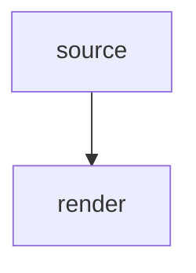

Draw what must not be missed, never ordinary prose. Enumerable facts of one shape (options, layers,
versions, counts) are such a draw: they go under `columns` or `lines`, and prose keeps the reasoning,
never the enumeration. Put the decorator line IMMEDIATELY above ordinary markdown, with no blank line
between them.

Rows split into columns, two to eight side by side while they fit the terminal. A table that does not fit
draws each row as an entry, one `Header: value` line per cell under its first:

```
@{view:columns}
| Item | Info |
| --- | --- |
| Status | all green |
```

The header row is REQUIRED, as it is in any markdown table: a table without one is not a table and
nothing is drawn, the block printing itself as raw text instead. Its cells may be empty (`|  |  |`) when
the table wants no visible header.

The same table under `@{view:lines}` is ruled under each entry instead of split.

A framed block, for the one summary a reader must not scroll past. Its header row is the FRAME and not
column names: the first cell is the title, the last is a badge set into the top rule. An empty label
cell continues the section above:

```
@{view:box}
| TL;DR | |
| --- | --- |
| SAID | the flaky retry test is fixed, a shared fixture was the cause |
| NEXT | bump the patch version, or wait for the queue refactor? |
```

One alert band, for the one fact a reader must not skim past: a risk, a blocked release, the number
that changes the decision. Never two in an answer, since a screen carrying three bands carries none:

```
@{view:banner}
> [!WARNING]
> two flaky suites, publication is blocked
```

One sentence set apart, colour only:

```
@{view:quote, tone:gold}
> the line you would have written anyway
```

A rule on its own:

```
@{view:hr}
```

<!-- needs:diagram -->
A diagram, drawn in the terminal, for the one structure prose would flatten: a flow, a dependency, a
lifecycle. The decorator sits over an ordinary mermaid fence, which is the ONLY data it takes, and the
fence stays a diagram that draws itself anywhere this hook does not run.

````
@{view:mermaid}

````

Two zones side by side, for a diagram beside the words that explain it. `split` takes no data of its
own, only the two zones written under it, each drawn in a column: a bare mermaid fence is a diagram, a
bare markdown fence is `markdown`, drawn to its column (headings, lists, quotes, bold, code), a bare quote
is a quote, and any decorated zone can be a side. One blank line may part the two sides, and a quote
written first needs it. Too narrow for two columns, the sides stack.

````
@{view:split}

```markdown
## What it shows
- the message leaves **raw**
- the hook draws it again
```
````

One zone set aside, for a diagram the rest of the message reads beside. `aside` takes one zone, any
side a split takes, and what follows flows in the column at its right, each paragraph, list or view
whole, until the zone's height is filled; the rest returns to the full width. A table, a split or
another aside ends the column. Too narrow for a column of text, the zone draws alone.

````
@{view:aside}


A paragraph, drawn in the column beside the diagram.
````
<!-- /needs:diagram -->

These are the main views to build on. `type:` names the KIND of content and `tone:` names the LOOK
alone, outranking the kind; both take any word, and an unknown one simply falls back: `tone:gold`,
`tone:dim`, `type:warning`. In a banner prefer `[!NOTE]`, `[!TIP]`, `[!IMPORTANT]`, `[!WARNING]` or
`[!CAUTION]`: those five are the ones markdown itself draws as an alert box where this hook does not run.

A tone the palette does not know draws the view's own default and reports nothing, so an invented name
is a silence, never an error. These are the ones that exist:

Tones: `red` `green` `yellow` `blue` `magenta` `cyan` `orange` `gold` `purple` `violet` `pink` `teal`
`aqua` `lime` `brown` `navy` `salmon` `mint` `dim`, and by meaning rather than by hue `pass` `warn`
`fail` `high` `med` `low` `key` `info` `success` `warning` `error` `note` `tip` `important` `caution`.

`hr` spends no tone: a rule is a rule. <!-- needs:diagram -->`mermaid` spends none either, a diagram
arriving already painted, its own colours saying something about the graph that a tone would bury.
`split` and `aside` spend none of their own, each zone wearing its view's.
<!-- /needs:diagram -->The other five already carry
one that suits them, so name a tone only where the colour itself says something the words do not. In
`box` it paints the labels and the gutter bar together, never one section apart from the rest.
