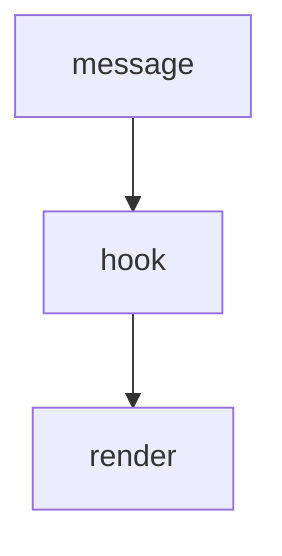

@{view:aside}

The hook reads every message Claude Code prints, and draws the blocks a view names.

Prose flows in the column beside the diagram, paragraph by paragraph, each one whole.

- a list flows in the column too
- and so does any view that fits

A paragraph flows there as long as the diagram's height lasts, filling the rows that remain.

The first one past it returns to the full width, right where it was written.
